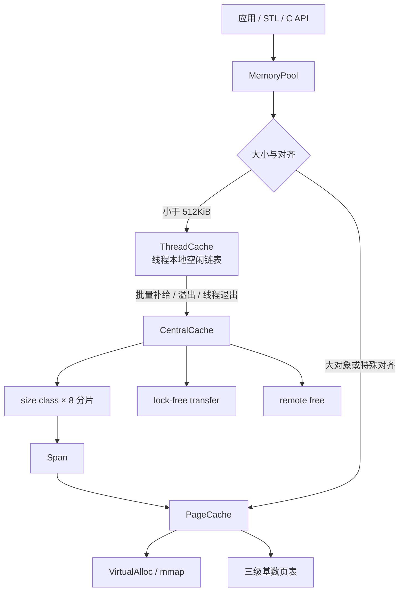
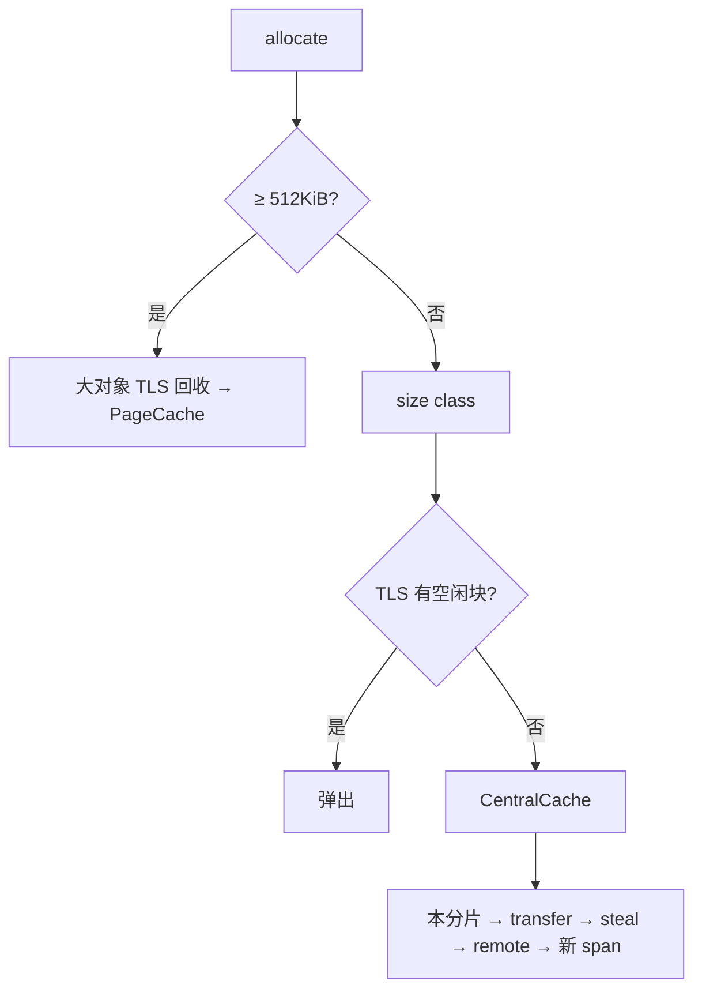
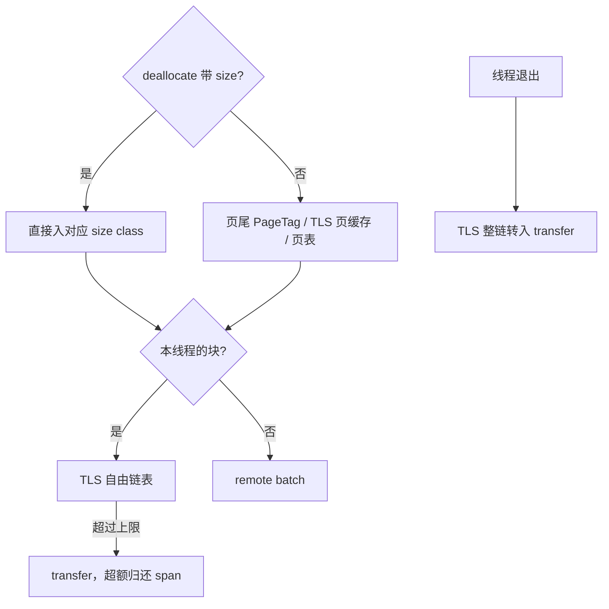

<!-- markdownlint-disable MD013 MD033 MD060 -->

# my-MemoryPool

C++17 内存池。推荐 **v3**：线程本地缓存 → 按 size class 分片的中央缓存 → 页缓存，用来降低系统分配器调用和多线程锁竞争。

小对象路径覆盖 **8B–512KiB**。池里拿到的指针必须用本项目接口释放，不能和 `free` / `delete` 混用。非法输入返回 `nullptr`；`Allocator<T>` 把失败转成 `std::bad_alloc`。

## 对外 API

头文件在 `v3/include/kama/`。下面与源码一致，没有列出未导出或未使用的符号。

### C++：`MemoryPool.h`

```cpp
namespace Kama_memoryPool {

constexpr std::size_t kAlignment = 8;
constexpr std::size_t kMaxBytes  = 512 * 1024;   // 512KiB

class MemoryPool {
public:
    static void* allocate(std::size_t size);
    static void* allocateAligned(std::size_t size, std::size_t alignment);
    static void  deallocate(void* ptr);                 // unsized
    static void  deallocate(void* ptr, std::size_t size); // sized，更快
    static MemoryPoolStats stats();

    template<typename T, typename... Args>
    static T* newElement(Args&&... args);   // 构造失败会释放内存并重新抛出

    template<typename T>
    static void deleteElement(T* p);        // 先析构再 deallocate
};

template<typename T, typename... Args>
T* newElement(Args&&... args);              // 等价于 MemoryPool::newElement

template<typename T>
void deleteElement(T* p);
}
```

| 函数 | 行为 |
|---|---|
| `allocate(size)` | `size == 0` 按 8 字节处理；`size >= kMaxBytes` 走大对象 span |
| `allocateAligned(size, alignment)` | `alignment` 必须是 2 的幂且非 0，否则 `nullptr`；`alignment <= 8` 时等同 `allocate` |
| `deallocate(ptr)` | `ptr == nullptr` 为空操作；通过页标签 / 页表恢复 size class |
| `deallocate(ptr, size)` | 调用方提供 size，避免查找 |
| `stats()` | `reservedBytes` / `cachedPageBytes` 始终有效；其余计数需编译时打开 `KAMA_MEMORY_POOL_ENABLE_STATS` |

### C++：`Allocator.h`

STL 兼容分配器，可用于 `std::vector<T, Kama_memoryPool::Allocator<T>>`。

```cpp
template<typename T>
class Allocator {
public:
    using value_type = T;
    T* allocate(std::size_t n);                 // 失败抛 std::bad_alloc
    void deallocate(T* p, std::size_t n) noexcept;
};
```

`alignof(T) <= 8` 时走 sized 路径；更大对齐走 `allocateAligned` + unsized free。

### C：`kama_memory_pool.h`

```c
void* kama_alloc(size_t size);
void* kama_alloc_aligned(size_t size, size_t alignment);
void  kama_free(void* ptr);
void  kama_free_sized(void* ptr, size_t size);
```

分别对应 `MemoryPool::allocate` / `allocateAligned` / `deallocate` / `deallocate(ptr, size)`。

### 示例

```cpp
#include <kama/MemoryPool.h>
#include <kama/Allocator.h>
#include <kama/kama_memory_pool.h>
#include <vector>

void demo() {
    using namespace Kama_memoryPool;

    void* p = MemoryPool::allocate(64);
    MemoryPool::deallocate(p, 64);

    int* n = MemoryPool::newElement<int>(7);
    MemoryPool::deleteElement(n);

    std::vector<int, Allocator<int>> values;
    values.push_back(42);

    void* q = kama_alloc(32);
    kama_free(q);
}
```

## 仓库结构

```text
my-MemoryPool/
├── v1/     教学版：固定槽大小 + 无锁自由链表
├── v2/     三层缓存早期实现
├── v3/     推荐版本
│   ├── include/kama/     对外头文件
│   ├── src/              ThreadCache / CentralCache / PageCache
│   ├── tests/            unit_test、perf_test
│   ├── examples/
│   └── CMakeLists.txt
└── README.md
```

日常使用只需要 v3。v1 / v2 保留作对照。

| 版本 | 模型 | 小对象上限 |
|---|---|---|
| v1 | 每档一个固定槽池 | 512B |
| v2 | 三层缓存初版 | 256KiB |
| v3 | 三层缓存 + 分片 + 页标签 + transfer | 512KiB |

## 架构



同线程小对象只在 ThreadCache 链表上 pop/push。中央层处理批量补给、跨线程归还和线程退出。页层向系统申请/归还页，空闲页缓存上限约 64MiB。





unsized free（只给指针）是相对 glibc 的关键路径：≤256B 的页在页尾写 `PageTag`，同页 O(1) 恢复 size class。

## 构建

CMake 3.14+、C++17。未开 sanitizer 时 Release 会尝试打开 LTO/LTCG。

```bash
cmake -S v3 -B v3/build-release -DCMAKE_BUILD_TYPE=Release \
  -DKAMA_MEMORY_POOL_BUILD_TESTS=ON -DKAMA_MEMORY_POOL_BUILD_EXAMPLES=ON
cmake --build v3/build-release --config Release --parallel
```

| 选项 | 默认 | 说明 |
|---|---|---|
| `KAMA_MEMORY_POOL_BUILD_TESTS` | ON | `unit_test` / `perf_test` |
| `KAMA_MEMORY_POOL_BUILD_EXAMPLES` | ON | `kama_example` |
| `KAMA_MEMORY_POOL_BUILD_SHARED` | OFF | 共享库 |
| `KAMA_MEMORY_POOL_ENABLE_STATS` | OFF | 热路径原子计数，测速请关 |
| `KAMA_MEMORY_POOL_ENABLE_DEBUG_GUARDS` | OFF | double free / 错误 size |
| `KAMA_MEMORY_POOL_ENABLE_ASAN` / `UBSAN` / `TSAN` | OFF | TSan 不能和 ASan/UBSan 一起 |

```bash
cmake --build v3/build-release --config Release --target run_unit_tests
cmake --build v3/build-release --config Release --target perf
```

Linux：`bash v3/run_linux_quick.sh`，或 `docker build -f v3/Dockerfile.linux_perf -t kama-mp v3`。

## 测试

`unit_test` 覆盖：小/中/大对象、size class 边界、对齐、非法输入、C API、STL Allocator、`newElement` 异常回滚、多线程、跨线程 sized/unsized free、线程退出、页缓存上限、长随机压力。本轮 Windows / Linux Release 均为 **All tests passed**。

`perf_test` 对比 `MemoryPool` / `new[]+delete[]` / `malloc+free`。核心场景 9 次取中位数，可扩展矩阵 3 次取中位数。快于基线 5% 为 WIN，慢于 5% 为 LOSE，否则 TIE。对 new 和 malloc 各判一次；**任一 LOSE 则进程返回非 0**。

## 性能数据

以下为 **2026-09-07 本机单次套件输出**（未四舍五入），单位毫秒，越小越好。统计和 Debug Guards 关闭。换机器或负载后请自行跑 `perf_test`。

### Windows 11 / MSVC Release + LTCG

`unit_test` 通过。`perf_test`：**48 WIN / 0 TIE / 0 LOSE**。结束后 `reservedBytes=108134400`（103.12 MiB），`cachedPageBytes=65929216`（62.88 MiB）。

| 场景 | v3 | new/delete | malloc/free | vs new | vs malloc |
|---|---:|---:|---:|---|---|
| 32B sized ×100000 | 1.713 | 4.665 | 4.471 | WIN | WIN |
| 32B unsized ×100000 | 1.517 | 4.440 | 4.762 | WIN | WIN |
| 4 线程 sized ×100000 | 6.445 | 22.325 | 20.284 | WIN | WIN |
| 4 线程 unsized ×100000 | 7.454 | 18.699 | 17.821 | WIN | WIN |
| 混合 16B–2048B sized ×50000 | 2.311 | 6.863 | 4.332 | WIN | WIN |
| 混合 16B–2048B unsized ×50000 | 2.808 | 3.787 | 3.410 | WIN | WIN |
| 跨线程 sized 64B ×50000 | 1.438 | 1.966 | 1.803 | WIN | WIN |
| 跨线程 unsized 64B ×50000 | 1.275 | 1.968 | 1.801 | WIN | WIN |
| 流水线 sized 64B ×50000 | 3.260 | 8.703 | 8.359 | WIN | WIN |
| 流水线 unsized 64B ×50000 | 3.341 | 9.254 | 8.634 | WIN | WIN |
| 高存活 64B ×100000 | 1.811 | 3.623 | 4.318 | WIN | WIN |
| 对齐 96B / 64-align ×50000 | 1.248 | 1.881 | 1.781 | WIN | WIN |
| 大对象 512KB ×200 | 0.005 | 0.283 | 0.289 | WIN | WIN |
| STL Allocator ×4000 | 0.279 | 0.317 | 0.330 | WIN | WIN |
| 冷 512KB ×100（1 存活） | 0.002 | 0.111 | 0.112 | WIN | WIN |
| vector 2e4 ints ×200 | 2.810 | 4.841 | 4.799 | WIN | WIN |
| size-class churn sized | 0.019 | 0.063 | 0.056 | WIN | WIN |
| size-class churn unsized | 0.022 | 0.054 | 0.053 | WIN | WIN |
| 8 线程 unsized burst ×50000 | 5.705 | 12.598 | 10.195 | WIN | WIN |
| 高存活 unsized 64B | 2.245 | 4.027 | 3.830 | WIN | WIN |

可扩展矩阵（每线程 25000 次，3 次中位数），全部 WIN。表中为 pool / malloc：

| 大小 | 1 线程 | 2 线程 | 4 线程 | 8 线程 |
|---:|---:|---:|---:|---:|
| 16B | 0.389 / 1.005 | 0.504 / 1.298 | 0.714 / 1.688 | 1.401 / 3.379 |
| 32B | 0.402 / 1.231 | 0.419 / 1.720 | 0.633 / 1.939 | 0.820 / 3.389 |
| 64B | 0.379 / 1.173 | 0.425 / 1.544 | 0.502 / 1.884 | 0.756 / 3.140 |
| 256B | 0.425 / 1.205 | 0.460 / 1.614 | 0.637 / 1.957 | 0.990 / 3.424 |
| 1KB | 0.459 / 1.083 | 0.428 / 1.471 | 0.531 / 2.009 | 0.900 / 3.919 |
| 4KB | 0.512 / 1.795 | 0.512 / 1.673 | 0.591 / 2.289 | 1.073 / 4.468 |
| 64KB | 0.537 / 34.988 | 0.672 / 109.526 | 1.013 / 331.119 | 1.611 / 970.413 |

### Linux / Ubuntu 22.04 / GCC Release + LTO（WSL，`-O3 -march=native`）

`unit_test` 通过。`perf_test`：**46 WIN / 2 TIE / 0 LOSE**。结束后 `reservedBytes=99876864`（95.25 MiB），`cachedPageBytes=65798144`（62.75 MiB）。

两个 TIE 均未慢于系统：冷 512KB 对 `malloc` 为 0.001 vs 0.000；vector 扩容对 `new/delete` 为 1.441 vs 1.479（快约 2.6%，未过 5% 阈值）。

| 场景 | v3 | new/delete | malloc/free | vs new | vs malloc |
|---|---:|---:|---:|---|---|
| 32B sized ×100000 | 0.888 | 3.296 | 3.173 | WIN | WIN |
| 32B unsized ×100000 | 1.043 | 3.130 | 3.036 | WIN | WIN |
| 4 线程 sized ×100000 | 4.416 | 6.878 | 5.893 | WIN | WIN |
| 4 线程 unsized ×100000 | 5.149 | 7.019 | 6.354 | WIN | WIN |
| 混合 16B–2048B sized ×50000 | 2.016 | 4.402 | 3.236 | WIN | WIN |
| 混合 16B–2048B unsized ×50000 | 1.840 | 3.452 | 3.212 | WIN | WIN |
| 跨线程 sized 64B ×50000 | 0.875 | 2.820 | 2.800 | WIN | WIN |
| 跨线程 unsized 64B ×50000 | 1.085 | 3.075 | 2.848 | WIN | WIN |
| 流水线 sized 64B ×50000 | 5.647 | 14.515 | 14.142 | WIN | WIN |
| 流水线 unsized 64B ×50000 | 5.407 | 14.834 | 14.122 | WIN | WIN |
| 高存活 64B ×100000 | 1.967 | 4.413 | 3.277 | WIN | WIN |
| 对齐 96B / 64-align ×50000 | 0.974 | 1.654 | 1.832 | WIN | WIN |
| 大对象 512KB ×200 | 0.003 | 0.008 | 0.008 | WIN | WIN |
| STL Allocator ×4000 | 0.093 | 0.117 | 0.113 | WIN | WIN |
| 冷 512KB ×100（1 存活） | 0.001 | 0.003 | 0.000 | WIN | TIE |
| vector 2e4 ints ×200 | 1.441 | 1.479 | 1.565 | TIE | WIN |
| size-class churn sized | 0.009 | 0.024 | 0.015 | WIN | WIN |
| size-class churn unsized | 0.010 | 0.024 | 0.015 | WIN | WIN |
| 8 线程 unsized burst ×50000 | 3.647 | 4.446 | 3.873 | WIN | WIN |
| 高存活 unsized 64B | 2.008 | 4.043 | 3.408 | WIN | WIN |

可扩展矩阵全部 WIN（pool / malloc）：

| 大小 | 1 线程 | 2 线程 | 4 线程 | 8 线程 |
|---:|---:|---:|---:|---:|
| 16B | 0.285 / 0.806 | 0.512 / 0.798 | 0.441 / 0.877 | 0.625 / 1.468 |
| 32B | 0.170 / 0.843 | 0.255 / 0.799 | 0.345 / 0.890 | 0.454 / 1.597 |
| 64B | 0.209 / 0.886 | 0.247 / 0.917 | 0.316 / 0.926 | 0.509 / 1.947 |
| 256B | 0.249 / 0.988 | 0.296 / 0.956 | 0.343 / 1.006 | 0.620 / 1.777 |
| 1KB | 0.255 / 0.964 | 0.290 / 0.957 | 0.354 / 1.293 | 0.604 / 2.156 |
| 4KB | 0.531 / 1.287 | 0.530 / 1.254 | 0.551 / 1.285 | 1.040 / 2.068 |
| 64KB | 0.539 / 20.025 | 0.683 / 22.556 | 1.101 / 26.757 | 1.919 / 41.168 |

## 注意事项

- 测速请关闭统计和 Debug Guards。发布前建议在目标平台跑 ASan、UBSan 或 TSan。
- 页缓存上限约 64MiB，超出的空闲页还回系统。
- 仓库目前没有单独的许可证文件。
