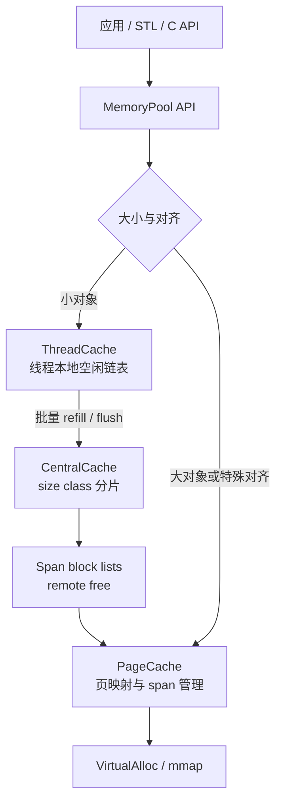

<!-- markdownlint-disable MD013 MD060 -->

# my-MemoryPool

一个面向高频小对象分配的 C++17 内存池。推荐使用 `v3`：它通过线程本地缓存、按 size class 分片的中央缓存和页缓存，减少通用分配器调用与多线程锁竞争。

## 项目介绍

v3 提供 `Kama_memoryPool::MemoryPool`、`newElement/deleteElement`、`Allocator<T>` 以及 `kama_alloc`/`kama_free`/`kama_alloc_aligned`/`kama_free_sized` C ABI。请求按大小和对齐路由到小对象或大对象路径；非法输入返回 `nullptr`，STL allocator 将失败转换为 `std::bad_alloc`。可选功能包括 Debug Guards、统计信息和 ASan/UBSan/TSan。

## 架构



```text
my-MemoryPool/
├── v1/  固定大小分配器教学版本
├── v2/  三层缓存早期实现
├── v3/  推荐版本（include/kama、src、tests、examples、cmake）
└── README.md
```

## 构建与使用

需要 CMake 3.14+、C++17 编译器和线程库。

```bash
cmake -S v3 -B v3/build-release -DCMAKE_BUILD_TYPE=Release \
  -DKAMA_MEMORY_POOL_BUILD_TESTS=ON -DKAMA_MEMORY_POOL_BUILD_EXAMPLES=ON
cmake --build v3/build-release --parallel
```

```cpp
#include <kama/MemoryPool.h>
#include <kama/Allocator.h>
#include <vector>

void demo() {
    void* p = Kama_memoryPool::MemoryPool::allocate(64);
    Kama_memoryPool::MemoryPool::deallocate(p, 64);
    std::vector<int, Kama_memoryPool::Allocator<int>> values;
    values.push_back(42);
}
```

## 测试覆盖

```bash
cmake --build v3/build-release --target run_unit_tests
cmake --build v3/build-release --target perf
ctest --test-dir v3/build-release --output-on-failure
```

单元测试覆盖基本分配/写入、size class 边界、0/超大尺寸、对齐、sized/unsized free、跨线程释放、线程退出回收、STL/C API、异常安全、随机长流量、无泄漏和可选 Debug Guards。性能测试覆盖 16B、32B、64B、256B、1KB、4KB、64KB，1/2/4/8 线程、混合大小及跨线程所有权转移，并对比 `new/delete`、`malloc/free`。

## 性能数据

以下为 Release、本地统计和 Debug Guards 关闭时的基准记录；多次运行取中位数，单位为毫秒。硬件、编译器和负载会影响结果，请在目标机器复测。

### Windows 11 / MSVC

| 场景 | v3 | new/delete | malloc/free |
|---|---:|---:|---:|
| 32B × 100000 | 2.564 | 5.395 | 5.401 |
| 4 线程 × 25000 | 3.069 | 5.596 | 5.937 |
| 16B–2048B 混合 × 50000 | 4.700 | 13.978 | 15.357 |
| 跨线程释放，64B × 50000 | 2.129 | 2.587 | 2.313 |

### Linux / Ubuntu 22.04 / GCC

| 场景 | v3 | new/delete | malloc/free |
|---|---:|---:|---:|
| 32B × 100000 | 2.683 | 4.120 | 4.013 |
| 4 线程 × 25000 | 3.977 | 4.032 | 2.374 |
| 16B–2048B 混合 × 50000 | 2.832 | 8.398 | 7.876 |
| 跨线程释放，64B × 50000 | 1.751 | 1.405 | 1.199 |

Linux 记录中的池统计为 `reservedBytes=67534848`、`cachedPageBytes=65175552`，页缓存上限为 64 MiB。可用 `v3/Dockerfile.linux_perf` 复现实验环境；该 Dockerfile 不是自动 CI 工作流。

## 注意事项

- 内存池指针必须使用本项目接口释放，不能与 `free` 或 `delete` 混用。
- 生产环境通常关闭统计和 Debug Guards；发布前建议在目标平台运行 ASan、UBSan/TSan 及长时间随机压力测试。
- 当前项目用于学习和研究，正式商用前请确认授权和合规要求。

## 许可证

仓库当前未附带独立许可证文件；使用前请确认项目所有者的授权条款。
